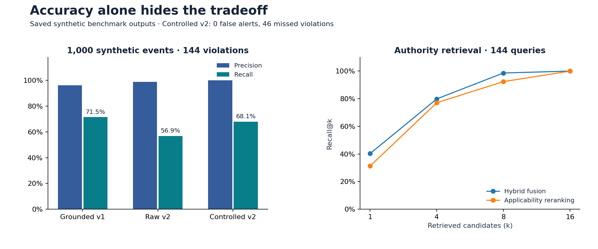

# Industrial Safety & Compliance Auditor

A local, retrieval-grounded safety auditor for intermodal yard operations. It evaluates operational observations against federal safety authorities, verifies citations, and sends unsupported or ambiguous cases to review.

The project combines structured safety rules, local language models, authentic incident narratives, deterministic controls, and a camera-neutral observation interface. Operational data and model inference remain local.

## Data analytics and experimental results

This project also documents the analysis behind the build: data profiling, baseline comparisons, source-group validation, confidence bounds, error analysis, and probability calibration. The [results report](docs/RESULTS.md) shows saved runs, their denominators, and the decisions they support, including ties and a calibration experiment that did not improve validation scores.



Explore the [1,000-event audit and retrieval analysis](docs/RESULTS.md#1-audit-tradeoffs-and-retrieval), [fine-tuning results](docs/RESULTS.md#2-fine-tuning-distinguish-format-from-domain-correctness), and [Person development comparisons](docs/RESULTS.md#3-person-detection-compare-models-on-the-same-source-groups). The vision results are historical development snapshots; this public checkout can recompute their metrics from anonymous predictions, while the full vision training tools are being prepared separately.

Run `python code/public_results.py --check` to verify the report without downloading models. See the [analytics workflow](docs/ANALYTICS_WORKFLOW.md) for metric definitions, reproducibility, and how future runs enter the record. Independent evaluation and model promotion remain separate from these development results.

**Latest retrieval development result:** incident-focused queries recovered eight of the nine walkthrough misses: **55/64 → 63/64** expected authorities within the top 16. A frozen comparison on the other 80 public cases improved **71/80 → 77/80**. The [before-and-after report](docs/RETRIEVAL_IMPROVEMENT.md) includes readable charts, every original miss, remaining failures, four first-rank regressions, and reproduction commands. These are known synthetic development cases; independent evaluation remains separate.

**Source-group allocation:** the [split-balance report](docs/GROUP_SPLIT_IMPROVEMENT.md) shows a 70/15/15 synthetic example improving from **132/84/84 to 210/45/45 rows**, with whole source groups preserved. It also reports all 100 exploratory cases, including eight where the allocation score worsened. These are data-allocation checks, not model-performance results.

## Decision and scoring contract

A control word alone is not enough to clear an event. “The walkway was not cleaned” must not be treated like “the walkway was cleaned.” The policy now checks common denials, planned or late action, continuing exposure, and controls applied to another object. These checks cover specific language patterns; uncertain cases still need review.

New audit runs use `selective_binary_v2`. Only `CLEAR` and `VIOLATION` become binary decisions. `REVIEW`, malformed replies and inference failures stay unresolved, and missing labels stay missing. Strict accuracy counts correct decisions across all labeled cases, including unresolved cases. Reports also show decision coverage, review volume and failures, so readers can see how often the system declined or failed to decide.

The [decision and scoring report](docs/DECISION_SCORING.md) explains the fixes with before-and-after examples. Historical reports keep their original evidence and scoring definitions. These regression checks establish software behavior; independent evaluation and model promotion remain separate.

## Useful help while a decision is open

If someone reports loose equipment above an aisle, the response should explain what could go wrong and what to do next. The interactive notebook and terminal walkthrough now give a practical first assessment, conditional precautions, relevant evidence leads, and a small number of follow-up questions. `REVIEW` keeps an unsupported legal conclusion open while still helping with the reported condition.

Focused searches keep the original observation intact. Evidence leads include verbatim passages and source offsets; the combined candidate ranks remain visible. Equipment height alone does not establish worker fall exposure, and a denied hazard must not become an asserted one. These are bounded language checks, not unrestricted understanding of every description.

The [useful-assessment workflow and data plan](docs/USEFUL_SAFETY_ASSESSMENT.md) explains the charger example and how reviewed, versioned evidence can improve coverage. The default walkthrough still makes no model requests or training updates. Its published-reference benchmark is labeled separately from the focused interactive search path.

The [wording comparison](docs/WORDING_RETRIEVAL.md) follows a real miss: “oil spill” did not retrieve the same evidence as “oil spills.” The walkthrough now shows additional wording-based evidence with verbatim passages, while keeping its primary ranking and decision checks separate. Questions and hypotheticals receive research evidence without being treated as reported violations. The expanded ranker is available with `--retrieval-profile wording`; it remains experimental because it recovered more authorities but also worsened some first-place matches. The report includes those regressions and the optional local semantic comparison.

## Start with the notebook

Before publishing changes or reports, follow the [publication privacy checks](docs/PUBLICATION_PRIVACY.md). They help keep credentials, private reviews, personal paths, and saved notebook outputs out of shared files. Independent evaluation and model promotion keep their own approval gates.

I want someone new to this project to be able to open it, try an incident, and see why it returned that result. [main.ipynb](main.ipynb) walks through the actual backend, with explanations beside the code. The deeper scripts are still available below.

The default notebook runs on the CPU. It does not need a GPU, Ollama, a camera, a model download, or an account. It does not train or change learning memory. You need internet access for the initial repository and package downloads. After setup, the walkthrough runs locally without model requests.

Here is what we have actually checked:

| Device or workflow | Current support |
| --- | --- |
| Windows CPU walkthrough and notebook | Covered by automated checks with Python 3.14; the commands below support PowerShell 5.1. |
| Linux CPU walkthrough and notebook | Covered by automated checks on Ubuntu with Python 3.11. |
| macOS CPU walkthrough and notebook | A terminal recipe is provided below; macOS is not currently tested in CI. |
| QLoRA training | Requires a compatible NVIDIA GPU, driver, CUDA-enabled PyTorch, and enough GPU memory. CPU, Apple GPU/MPS, and AMD/ROCm training are not implemented by this trainer. |

The steps numbered below are for Windows. On Linux or macOS, use the [CPU quickstart](#linux-and-macos-cpu-quickstart). A passing CPU walkthrough does not verify a device's training stack.

### 1. Check Git and Python

Install [Git](https://git-scm.com/downloads) and [Python](https://www.python.org/downloads/) if needed, then open a new PowerShell window. Run:

```powershell
$ErrorActionPreference = 'Stop'
git --version
if ($LASTEXITCODE -ne 0) { throw 'Git is unavailable. Stop and fix that first.' }
python --version
if ($LASTEXITCODE -ne 0) { throw 'Python is unavailable. Stop and fix that first.' }
```

Both commands should print a version. Use Python 3.11 or newer; automated checks cover Python 3.11 on Linux and 3.14 on Windows. If Windows does not recognize `python`, try `py --version`. If that works, replace bare `python` commands below with `py`; keep the explicit `.venv` interpreter paths as written. Otherwise, finish installing Python and reopen PowerShell before continuing.

### 2. Install and open the notebook

Choose **one** checkout option first. Run these blocks in PowerShell, not inside a notebook cell. A failed clone must not send the next commands into an older checkout. The selection below sets `SafetyProjectRoot`; repeat it when opening a new terminal.

**Recommended: fresh public clone.** This block chooses a folder named `Industrial_Safety_Agent_Public` under your Windows user folder and prints its full path. You do not need to enter your name or guess a destination. If you want another location, change only the `$destination` assignment to a full path for a new folder outside your development checkout. Existing folders are never replaced.

```powershell
$global:SafetyProjectRoot = $null
& {
    $ErrorActionPreference = 'Stop'
    $destination = Join-Path $env:USERPROFILE 'Industrial_Safety_Agent_Public'
    if (-not [System.IO.Path]::IsPathRooted($destination)) { throw 'Use a full path.' }
    Write-Host "Public checkout folder: $destination"
    if (Test-Path -LiteralPath $destination) { throw "That folder already exists: $destination. Select that public checkout below, or choose a new destination. Nothing was replaced." }
    git clone https://github.com/SamsonMortensen/Industrial_Safety_Agent.git $destination
    if ($LASTEXITCODE -ne 0) { throw 'Clone failed. No checkout was selected; stop here.' }
    Set-Location -LiteralPath $destination
    python -B code/check_public_checkout.py
    if ($LASTEXITCODE -ne 0) { throw 'Public checkout validation failed. Stop before installing anything.' }
    $global:SafetyProjectRoot = (Get-Location).Path
}
```

**Already have a public clone?** Use this option instead. Paste the full path to the project directory itself, which the default setup names `Industrial_Safety_Agent_Public`. A Windows user folder or a Documents folder alone is not the checkout. If a separate public folder was prepared for you, select that exact folder; do not select your older development build just because its name looks familiar.

The check below rejects a checkout with changed source or additional Python modules in `code` or `tests`, including ignored development files. It checks local source consistency, not whether GitHub has a newer revision. It does not delete files, reset Git, read private model/review directories, or install packages. An older checkout without this check needs a fresh clone for this path. Your development checkout stays available for its own workflow.

```powershell
$global:SafetyProjectRoot = $null
& {
    $ErrorActionPreference = 'Stop'
    $existing = Read-Host 'Full path to the EXISTING public checkout'
    Set-Location -LiteralPath $existing
    if (-not (Test-Path -LiteralPath '.\requirements.txt') -or -not (Test-Path -LiteralPath '.\code\showcase.py')) { throw 'This is not the project root. Stop and select the correct folder.' }
    if (-not (Test-Path -LiteralPath '.\code\check_public_checkout.py')) { throw 'This checkout lacks the public setup check. Use the fresh public clone above; keep the old build intact.' }
    git ls-files --error-unmatch -- code/check_public_checkout.py > $null
    if ($LASTEXITCODE -ne 0) { throw 'The public setup check is not tracked in this checkout. Use a fresh public clone.' }
    python -B code/check_public_checkout.py
    if ($LASTEXITCODE -ne 0) { throw 'Public checkout validation failed. Stop before installing anything.' }
    $global:SafetyProjectRoot = (Get-Location).Path
}
```

After that selection succeeds, install and open the notebook. These blocks work in Windows PowerShell 5.1: `$ErrorActionPreference` handles PowerShell errors, while each `$LASTEXITCODE` check stops a failed external program before the next step. Keep the surrounding `& { ... }` when copying a block.

```powershell
& {
    $ErrorActionPreference = 'Stop'
    if (-not $SafetyProjectRoot -or (Get-Location).Path -ne $SafetyProjectRoot) { throw 'Select a checkout above before installing anything.' }
    python -B code/check_public_checkout.py
    if ($LASTEXITCODE -ne 0) { throw 'Public checkout validation failed. Stop before installing anything.' }
    if (-not (Test-Path -LiteralPath '.\.venv\Scripts\python.exe')) {
        python -m venv .venv
        if ($LASTEXITCODE -ne 0) { throw 'Environment creation failed.' }
    }
    .\.venv\Scripts\python.exe -m pip install -r requirements.txt
    if ($LASTEXITCODE -ne 0) { throw 'Package installation failed. Do not continue to the notebook.' }
    .\.venv\Scripts\python.exe -m pip check
    if ($LASTEXITCODE -ne 0) { throw 'Resolve the dependency conflicts first.' }
    .\.venv\Scripts\python.exe -m ipykernel install --sys-prefix --name industrial-safety --display-name "Industrial Safety (.venv)"
    if ($LASTEXITCODE -ne 0) { throw 'Kernel registration failed.' }
    .\.venv\Scripts\python.exe -m notebook main.ipynb --ip=127.0.0.1
    if ($LASTEXITCODE -ne 0) { throw 'The notebook server did not finish successfully.' }
}
```

The package installation may take a few minutes. `Requirement already satisfied` is normal. `pip check` should report `No broken requirements found`. The kernel command connects this notebook to the same Python environment that received the packages; no environment activation is needed. Use the full `.\.venv\Scripts\python.exe -m pip` command whenever working on this environment. Bare `pip` can install into your user-wide Python instead; a successful install there does not repair this `.venv`.

Linux and macOS use a different shell; follow the complete [CPU quickstart](#linux-and-macos-cpu-quickstart) below instead of copying these PowerShell blocks.

### 3. Run the cells and try an incident

The notebook opens in your browser, served by your own computer. If it does not open automatically, use the local URL printed in the terminal. Keep that terminal open while working, and do not share its access token.

Select the **Industrial Safety (.venv)** kernel. Click the first code cell and press **Shift+Enter**, then continue down the notebook. **Run > Run All Cells** also works. The first cell should print `Setup ready`; later cells show example decisions, retrieved text, an editable incident, a small live benchmark, and clearly labeled earlier results. An asterisk beside a cell means it is running.

You do not need to run every script in this README to try the project. The notebook is the beginner path. Optional local models and training are separate workflows under [Advanced scripts and validation](#advanced-scripts-and-validation).

Jupyter can save your edits and outputs in the notebook. Avoid personal information, and clear your incident text and outputs before sharing a copy. To finish, shut down the kernel, then press **Ctrl+C** in the server terminal and confirm if asked.

### If something stops

- **`git` or `python` is not recognized:** finish installing it, reopen PowerShell, and repeat the version checks.
- **The destination folder already exists or cloning failed:** stop. The fresh-clone block prints its destination. Select that public folder with the existing-checkout option, or change `$destination` to a new folder. Do not substitute your development folder, delete it, or create a nested clone inside it.
- **`requirements.txt` or `main.ipynb` is not found:** check that the terminal is in the repository folder.
- **A notebook reports a missing module:** install `requirements.txt` with the exact project Python command above, repeat the kernel registration, and restart the notebook with **Industrial Safety (.venv)** selected. Bare `pip` may install into a different environment.
- **Local tests ask for `torch`, `streamlit`, `scipy` or `sklearn`:** the published CPU walkthrough does not need those packages. This usually means extra development tests are being discovered. Check the selected folder before installing anything else. The public checkout check should stop this mixture before installation or tests.
- **`json/regulations.json` differs from the named reproduction:** the saved comparison expects its frozen input. Use an unchanged public checkout to reproduce it; do not edit expected hashes or replace your development data to force a pass.
- **A cell refers to a name that is not defined:** restart the kernel and run the cells from the top.
- **You only installed `requirements-showcase.txt`:** that installs the CLI-only dependencies. Install `requirements.txt` before opening the notebook or running the full public validation checks.

### Linux and macOS CPU quickstart

Install Git and Python 3.11 or a newer version compatible with the dependencies. Ubuntu with Python 3.11 is the Linux CI configuration; this macOS recipe has not been CI-tested. Use a terminal running bash, zsh, or a POSIX-compatible shell. No PyTorch or GPU packages are needed for this path.

Enter the full path to either an existing public checkout or a new folder outside any existing checkout. Do not enter quotes around the path. The block reuses an existing checkout and only clones when the destination is absent. Keep the surrounding parentheses: they stop the dependent commands on failure without closing your terminal.

```sh
(
    set -eu
    git --version
    python3 -c 'import sys; print(sys.version); assert sys.version_info >= (3, 11), "Python 3.11 or newer is required"'
    printf 'Full checkout path (existing or new): '
    IFS= read -r safety_project
    case "$safety_project" in
        /*) ;;
        *) printf '%s\n' 'Use a full path beginning with /.' >&2; exit 1 ;;
    esac
    if [ -e "$safety_project" ]; then
        cd "$safety_project"
        if [ ! -e .git ] || [ ! -f requirements.txt ] || [ ! -f code/showcase.py ]; then
            printf '%s\n' 'That folder is not the project root. Stop and select the checkout.' >&2
            exit 1
        fi
        git rev-parse --show-toplevel
    else
        git clone https://github.com/SamsonMortensen/Industrial_Safety_Agent.git "$safety_project"
        cd "$safety_project"
    fi
    if [ ! -f code/check_public_checkout.py ]; then
        printf '%s\n' 'This checkout lacks the public setup check. Use a fresh public clone and keep the old build intact.' >&2
        exit 1
    fi
    git ls-files --error-unmatch -- code/check_public_checkout.py > /dev/null
    python3 -B code/check_public_checkout.py
    if [ ! -x .venv/bin/python ]; then
        python3 -m venv .venv
    fi
    .venv/bin/python -m pip install -r requirements.txt
    .venv/bin/python -m pip check
    .venv/bin/python code/check_setup.py
    .venv/bin/python -m ipykernel install --sys-prefix --name industrial-safety --display-name 'Industrial Safety (.venv)'
    .venv/bin/python -m notebook main.ipynb --ip=127.0.0.1
)
```

Select **Industrial Safety (.venv)** in the notebook and follow [step 3](#3-run-the-cells-and-try-an-incident). If you prefer the terminal walkthrough, replace the final notebook launch with `.venv/bin/python code/showcase.py`. If environment creation fails because `venv` is missing, install the venv support for your Python through your operating system's package manager, then rerun the block. Package or setup errors must be resolved before continuing.

## Prefer the terminal?

I want people to be able to see what this does without setting up a training machine. The walkthrough runs the actual backend with a smaller workload. It does not replay canned decisions.

It works through six different observations, shows what triggered each investigation, builds the queries, retrieves authorities, and returns a decision or sends the case to review. It also checks the citation guard, demonstrates the learning approval rules, and runs a 16-case retrieval benchmark across 16 hazard families.

You need Git and Python 3.11 or newer. No GPU, Ollama server, model download, or account is needed for the default run. On Windows, first choose a fresh or existing checkout in [step 2](#2-install-and-open-the-notebook), then run this CLI-only setup. Linux/macOS readers can use the [CPU quickstart](#linux-and-macos-cpu-quickstart) and its terminal option.

```powershell
& {
    $ErrorActionPreference = 'Stop'
    if (-not $SafetyProjectRoot -or (Get-Location).Path -ne $SafetyProjectRoot) { throw 'Select a checkout in step 2 first.' }
    python -B code/check_public_checkout.py
    if ($LASTEXITCODE -ne 0) { throw 'Public checkout validation failed. Stop before installing anything.' }
    if (-not (Test-Path -LiteralPath '.\.venv\Scripts\python.exe')) {
        python -m venv .venv
        if ($LASTEXITCODE -ne 0) { throw 'Environment creation failed.' }
    }
    .\.venv\Scripts\python.exe -m pip install -r requirements-showcase.txt
    if ($LASTEXITCODE -ne 0) { throw 'Package installation failed. Stop before running the walkthrough.' }
    .\.venv\Scripts\python.exe code/showcase.py
    if ($LASTEXITCODE -ne 0) { throw 'The walkthrough failed; inspect the first error.' }
}
```

There is no second clone step here.

The default run uses CPU-based lexical retrieval and the existing applicability and policy checks. Live results are labeled separately from the saved full-audit, hybrid-retrieval, incident-coverage, and QLoRA results. Those larger runs are not repeated by the walkthrough. The camera examples are structured observations, not live image recognition.

Try your own incident or keep the session open:

```powershell
.\.venv\Scripts\python.exe code/showcase.py --text "A wire-rope sling with broken outer wires remained in an active lift"
.\.venv\Scripts\python.exe code/showcase.py --interactive
```

For structured input, detailed evidence, or a larger sample:

```powershell
.\.venv\Scripts\python.exe code/showcase.py --input data/example_camera_observation.json --json
.\.venv\Scripts\python.exe code/showcase.py --benchmark-cases 64
.\.venv\Scripts\python.exe code/showcase.py --out benchmark_runs/showcase/my_first_run.json
```

The tour handles up to six observations and 64 benchmark cases per run. Use `--benchmark-cases 0` to skip the benchmark. It does not write learning memory, train models, or run anything in the background. Saving a report is optional; exports stay under the ignored showcase directory and cannot overwrite an existing file. To save another run, choose a new filename such as `my_second_run.json`. The interactive prompt is always offline and ends with `quit`.

If Ollama and a local model are already installed, you can allow one model request for a case the policy cannot resolve:

```powershell
.\.venv\Scripts\python.exe code/showcase.py --reasoner --model qwen3.5:9b --timeout 30
```

That request uses lexical retrieval, the existing citation guard, a limited context, and a 220-token generation limit. It does not build dense embeddings or download a model. The timeout is a network read timeout, not a guarantee of total runtime. A missing or unavailable model leaves the case in review. Smaller installed models can be selected with `--model`, but their output quality is not established by the saved QLoRA results.

This is a research system. A retrieved citation is not proof of a violation, and a clear result applies only to the condition checked. The full training and evaluation tools are still available below.

## What it does

- Evaluates text logs, incident narratives, camera observations, and sensor-derived events.
- Retrieves relevant OSHA, FRA, and statutory authorities with lexical and semantic search.
- Separates hazard detection, citation existence, citation grounding, and citation correctness.
- Applies deterministic controls when the legal scope and measurable facts are explicit.
- Requires every violation citation to appear in the retrieved candidate set.
- Returns `REVIEW` when the evidence or governing authority is uncertain.
- Stores only labeled or reviewer-approved outcomes for controlled future learning.

## Current capabilities

The current backend supports:

- walking-working surfaces and housekeeping;
- materials handling, powered industrial trucks, cranes, dockboards, and slings;
- electrical work practices and energized-part approach conditions;
- fall protection, ladders, stairways, and guardrails;
- freight train-employee duty limits under 49 U.S.C. 21103;
- selected FRA recordkeeping and passenger-service rules;
- stateful checks for cumulative duty time and recurring equipment defects;
- autonomous observation triggers based on change, anomaly, novelty, uncertainty, relationships, and human review flags.

## Measured results

### Full 1,000-event audit

The locked synthetic yard log contains 1,000 events, including 144 violations across 16 hazard families and a matched compliant counterpart for every planted violation.

| Metric | Grounded v1 | Raw v2 | Policy-controlled v2 |
| --- | ---: | ---: | ---: |
| True positives | 103 | 82 | 98 |
| False positives | 4 | 1 | 0 |
| False negatives | 41 | 62 | 46 |
| True negatives | 852 | 855 | 856 |
| Precision | 0.9626 | 0.9880 | **1.0000** |
| Recall | **0.7153** | 0.5694 | 0.6806 |
| F1 | **0.8207** | 0.7225 | 0.8099 |
| Accuracy | **0.9550** | 0.9370 | 0.9540 |
| Correct citation among true positives | 0.5728 | 0.8171 | **0.8571** |
| Status and citation jointly correct | 0.9110 | 0.9220 | **0.9400** |

Grounded v1 and v2 are separate model runs. Raw v2 and policy-controlled v2 are two evaluations of the same saved v2 outputs. The policy-controlled result used deterministic scope rules for 90 cases and retained the model result for the remaining 910.

Saved evidence:

- `json/full_audit_results.json`
- `json/full_audit_policy_controlled.json`
- `json/audit_results.json`

### Autonomous authority retrieval

This benchmark asks whether the governing authority can be retrieved from observable event fields. Labels are used only after retrieval for scoring.

| Retrieval method | Recall@1 | Recall@4 | Recall@8 | Recall@16 |
| --- | ---: | ---: | ---: | ---: |
| Multi-query hybrid fusion | **0.4028** | **0.7986** | **0.9861** | **1.0000** |
| Hybrid with applicability reranking | 0.3125 | 0.7708 | 0.9236 | **1.0000** |

Both methods retrieved the expected authority within the top 16 for all 144 violations in the saved run. Raw fusion ranked the expected authority earlier more often. These figures are computed from the per-case ranks in `json/autonomous_retrieval_benchmark.json`; they are not a field-performance claim.

### Fresh QLoRA result

A 4-bit QLoRA supervised fine-tune of `Qwen/Qwen2.5-3B-Instruct` used 70 synthetic training cases and a text-disjoint 56-case holdout. The trainer did not open the holdout.

| Matched holdout result | Base model | QLoRA adapter |
| --- | ---: | ---: |
| Cases | 56 | 56 |
| Strict verdict accuracy | 0.0000 | **0.8929** |
| F1 | 0.0000 | **0.8929** |
| Violation citation correctness | 0.0357 | **0.5714** |
| Verdict and citation both correct | 0.0000 | **0.7321** |
| Parsed in the required format | 0 of 56 | **56 of 56** |

The adapter is suitable for controlled narration and structured output experiments. Its citation correctness is not sufficient for autonomous legal decisions. Exact configuration, hashes, and per-case outputs are saved in:

- `json/finetune_training_report.json`
- `json/finetune_evaluation_results.json`
- `json/scaled_benchmark_hybrid_results.json`

### Authentic incident-text coverage

The OSHA Severe Injury Report pipeline profiled 105,996 records dated January 1, 2015 through November 30, 2025. Structured employer and location identifiers are removed before local normalization. Free-text narratives remain in ignored local storage and are not committed.

| Authentic OSHA stress test | Result |
| --- | ---: |
| Records sampled | 500 |
| Triggered for investigation | 500 |
| Non-empty top-16 candidate set | 500 |
| Distinct top-ranked authorities | 24 |
| Cases sent to review by the narrow policy | 498 |
| Policy citations supported by retrieval | 1 of 2 |
| Unsupported citations allowed | **0** |

Every sampled row is a known reported incident and is intentionally human-flagged. These figures measure ingestion, retrieval coverage, and citation gating. They do not measure pre-incident detection or legal accuracy.

Saved evidence:

- `json/osha_sir_profile.json`
- `json/authentic_incident_retrieval_hybrid.json`
- `data/incident_text_datasets.json`

## Safety architecture

```text
Observation -> Trigger -> Query plan -> Hybrid retrieval -> Applicability check
            -> Grounded policy or local reasoner -> Decision or REVIEW
```

1. `code/autonomous_investigator.py` accepts camera-neutral structured observations.
2. `code/fetch_regulations.py` and `code/build_section_index.py` build the legal corpus and section verifier.
3. `code/benchmark_autonomous_retrieval.py` evaluates authority retrieval independently from generation.
4. `code/hybrid_policy.py` handles high-confidence cases with explicit scope and facts.
5. `code/audit_agent.py` and `code/audit_agent_v2.py` run the grounded model audits.
6. `code/continuous_learner.py` stores trusted precedents and quarantines unverified outcomes.
7. `code/stateful_tracker.py` evaluates selected cross-event conditions.

## Continuous improvement

Continuous learning is controlled rather than self-modifying:

- only labeled or reviewer-approved decisions can enter trusted memory;
- an event cannot retrieve itself or a near-duplicate as a precedent;
- only earlier events are eligible as precedents;
- candidate training data remains separate from locked evaluation data;
- model weights are updated offline and promoted only after evaluation;
- the running model never trains directly on its own unreviewed predictions.

`code/temporal_eval.py` provides a frozen future-slice evaluation for measuring whether learned memory transfers to unseen events.

## Vision integration

The backend already accepts structured observations from a future camera or sensor pipeline. The vision layer remains a separate training and validation project.

- `data/vision_datasets.json` records dataset licenses and intended uses.
- `code/vision_manifest.py` creates group-level train, validation, and test splits.
- `data/example_camera_observation.json` demonstrates the observation contract.

Public dataset labels are treated as observations, not legal conclusions. Camera calibration, tracking, occlusion, privacy controls, local field labels, and external validation remain required before deployment.

## Regulatory and benchmark scope

The retrievable corpus includes selected authorities from:

- 29 CFR 1910 Subpart D, walking-working surfaces;
- 29 CFR 1910 Subpart N, materials handling and storage;
- 29 CFR 1910 Subpart S, electrical safety;
- 49 CFR 228, railroad hours-of-service recordkeeping and applicable passenger rules;
- 49 U.S.C. 21103, freight train-employee hours-of-service limits.

The current synthetic benchmark covers 16 hazard families:

| Area | Hazard families | Governing sections |
| --- | --- | --- |
| Walking-working surfaces | housekeeping, ladders, stairways, dockboards, fall protection, guardrails | 1910.22, .23, .25, .26, .28, .29 |
| Materials handling | aisle obstruction, rim wheels, lift trucks, cranes, slings | 1910.176, .177, .178, .179, .184 |
| Electrical | exposed live parts, approach distance, protective equipment | 1910.303, .333, .335 |
| Hours of service | freight train-employee duty limit, duty records | 49 U.S.C. 21103, 49 CFR 228.11 |

## Advanced scripts and validation

The notebook setup already installs `requirements.txt`, which also covers the public analysis and validation commands below. The CLI-only walkthrough needs only `requirements-showcase.txt`. Model training is optional and has separate requirements; the notebook does not start it.

### Prerequisites

- Git and Python 3.11 or compatible
- [Ollama](https://ollama.com) for live embedding and language-model runs; not required for saved-result validation or lexical-only examples

Commands below use Windows PowerShell from the repository root. First complete the [fresh or existing checkout selection](#2-install-and-open-the-notebook); do not clone again. The explicit Python paths avoid environment-activation and interpreter mismatches. The [Linux/macOS CPU recipe](#linux-and-macos-cpu-quickstart) handles initial setup in those shells. For individual Python commands below, use `.venv/bin/python`; the PowerShell variables and control blocks do not translate by replacing the interpreter path alone.

```powershell
& {
    $ErrorActionPreference = 'Stop'
    if (-not $SafetyProjectRoot -or (Get-Location).Path -ne $SafetyProjectRoot) { throw 'Select a checkout in step 2 first.' }
    python -B code/check_public_checkout.py
    if ($LASTEXITCODE -ne 0) { throw 'Public checkout validation failed. Stop before installing anything.' }
    if (-not (Test-Path -LiteralPath '.\.venv\Scripts\python.exe')) {
        python -m venv .venv
        if ($LASTEXITCODE -ne 0) { throw 'Environment creation failed.' }
    }
    .\.venv\Scripts\python.exe -m pip install -r requirements.txt
    if ($LASTEXITCODE -ne 0) { throw 'Package installation failed.' }
    .\.venv\Scripts\python.exe -m pip check
    if ($LASTEXITCODE -ne 0) { throw 'Resolve the dependency conflicts first.' }
    .\.venv\Scripts\python.exe code/check_setup.py
    if ($LASTEXITCODE -ne 0) { throw 'Project setup checks failed.' }
}
```

Virtual environments and trained adapters are not included in a clone.

### Validate the repository

Run these after installing `requirements.txt` with the project Python. These checks use the included reference files, require no GPU or model downloads, and do not rerun the 500-case benchmark. Notebook validation runs every code cell in a fresh kernel using the same Python interpreter. It blocks outbound socket and HTTP requests in the walkthrough and does not save the executed notebook.

```powershell
& {
    $ErrorActionPreference = 'Stop'
    if (-not $SafetyProjectRoot -or (Get-Location).Path -ne $SafetyProjectRoot) { throw 'Select the public checkout first.' }
    .\.venv\Scripts\python.exe -B code/check_public_checkout.py
    if ($LASTEXITCODE -ne 0) { throw 'Public checkout validation failed. Stop before running the tests.' }
    .\.venv\Scripts\python.exe -m compileall -q code tests
    if ($LASTEXITCODE -ne 0) { throw 'Compilation failed.' }
    .\.venv\Scripts\python.exe -m unittest discover -s tests -v
    if ($LASTEXITCODE -ne 0) { throw 'Tests failed. Stop before the remaining validation steps.' }
    .\.venv\Scripts\python.exe code/validate_notebook.py
    if ($LASTEXITCODE -ne 0) { throw 'Notebook validation failed.' }
    .\.venv\Scripts\python.exe code/validate_saved_evaluation.py
    if ($LASTEXITCODE -ne 0) { throw 'Saved-evaluation validation failed.' }
}
```

Expected: tests finish with `OK`, notebook validation confirms that all code cells ran, and saved-evaluation validation confirms matching metrics and the holdout hash. The saved-evaluation validator does not verify model weights. These are public-repository checks, not validation of additional private development files.

### Try an offline observation

```powershell
.\.venv\Scripts\python.exe code/run_autonomous_investigation.py data/example_camera_observation.json --sample-rate 0 --lexical-only
.\.venv\Scripts\python.exe code/benchmark_autonomous_retrieval.py --lexical-only --out benchmark_runs/autonomous_lexical.json
```

The observation command prints a structured decision with retrieved candidates. Lexical-only results are a smoke test, not a reproduction of the published hybrid scores. New example outputs go under ignored `benchmark_runs/`; rerunning a named output replaces that local result.

### Enable local models

Start the Ollama desktop app, or run `ollama serve` in another terminal if no server is already running. Then install the models once:

```powershell
ollama pull mxbai-embed-large
ollama pull qwen3.5:9b
.\.venv\Scripts\python.exe code/check_setup.py --ollama --embed
```

`OLLAMA_HOST` defaults to `http://localhost:11434`; an address such as `127.0.0.1:11434` is also accepted. `ollama ps` shows CPU/GPU placement while a model is loaded. Ollama execution and PyTorch CUDA are separate configurations.

### Run hybrid retrieval and small model audits

These commands make live model requests. The first dense run builds corpus embeddings and can take substantially longer than the offline checks. Start audits at one event and concurrency one; increase `--limit` to 50 or 1000 after checking runtime and memory. Unlike the notebook and walkthrough, `audit_agent_v2.py` also writes ignored local learning memory and run history; use a separate experimental checkout if you want to keep an existing memory unchanged.

```powershell
.\.venv\Scripts\python.exe code/run_autonomous_investigation.py data/example_camera_observation.json --sample-rate 0 --out benchmark_runs/observation_hybrid.json
.\.venv\Scripts\python.exe code/retrieval_diagnostic.py --out benchmark_runs/retrieval_diagnostic.json
.\.venv\Scripts\python.exe code/benchmark_autonomous_retrieval.py --out benchmark_runs/autonomous_hybrid.json
.\.venv\Scripts\python.exe code/audit_agent.py --limit 1 --concurrency 1 --out benchmark_runs/audit_v1.json
.\.venv\Scripts\python.exe code/audit_agent_v2.py --limit 1 --concurrency 1 --out benchmark_runs/audit_v2.json
.\.venv\Scripts\python.exe code/apply_policy_controls.py --raw benchmark_runs/audit_v2.json --out benchmark_runs/audit_v2_controlled.json
```

The observation example uses policy decisions unless `--reasoner` is added. Small runs check the execution path; they do not establish model quality or reproduce the full-audit results.

### Prepare authentic incident text

This is optional and requires a separate external download. The raw CSV and normalized incident file are not included in a clone. The beginner notebook reads the saved coverage report and does not need either file.

First download and extract the source:

```powershell
.\.venv\Scripts\python.exe code/fetch_osha_incidents.py
```

Do not continue until extraction succeeds and `data/external/osha_sir/January2015toNovember2025.csv` exists. If the download fails, use the manual-download instructions below. Then normalize the CSV:

```powershell
.\.venv\Scripts\python.exe code/osha_incident_pipeline.py --profile benchmark_runs/osha_sir_profile.json
```

After that command succeeds, `data/external/osha_sir/normalized_observations.jsonl` is available for the benchmark:

```powershell
.\.venv\Scripts\python.exe code/benchmark_authentic_incidents.py --sample 50
```

If OSHA refuses the automated download with HTTP 403, download the matching archive from the [OSHA Severe Injury Reports page](https://www.osha.gov/severe-injury-reports), save it in `data/external/osha_sir/`, and rerun the fetch command without `--force`. For a different release, supply its official `--url` to the fetch command and the extracted CSV through the pipeline's `--input` option. Do not describe a different release as the published reference dataset.

Add `--dense` to test hybrid retrieval once Ollama is ready; use `--sample 500` for a larger run. Dense runs also embed the regulation corpus, so reducing the sample does not remove that startup cost. Each authentic-incident benchmark saves a timestamped result under `benchmark_runs/authentic_incidents/` and refuses to overwrite published reference results.

### Rebuild source fixtures (optional)

The corpus, section index, and benchmark log are already included. Run these only in a separate experimental checkout: they replace those files, and changed corpus content requires rebuilding the embedding cache before further dense runs. The eCFR edition is pinned to January 1, 2025, not the current law.

```powershell
.\.venv\Scripts\python.exe code/fetch_regulations.py
.\.venv\Scripts\python.exe code/build_section_index.py
.\.venv\Scripts\python.exe code/generate_yard_log.py --records 1000
```

### Fine-tuning

Fine-tuning is optional, GPU-intensive, and separate from repository validation. The historical `train_lora_dpo.py` filename currently runs QLoRA supervised fine-tuning, not DPO reinforcement learning.

**The bundled historical training file is not ready for a new run under the current policy.** Rows `TR-0062` and `TR-0065` conflict with the current exposure checks. Those records and their old labels remain unchanged so the earlier results stay traceable. Review the facts and labels in a separate development training file; do not rewrite labels simply to make preflight pass. Until that review is complete, stop at hardware/setup checks. A working GPU does not resolve a label conflict.

The following training recipe is for Windows PowerShell and compatible NVIDIA/CUDA hardware. It does not provide a CPU, Apple GPU/MPS, or AMD/ROCm training path. Start from the selected checkout. Before creating the environment, check the Python support listed on the [official PyTorch installation page](https://pytorch.org/get-started/locally/) for your chosen build and the training dependencies. `python --version` must identify that interpreter; if it does not, use the intended interpreter's full path for `python -m venv` below. An existing environment retains its original Python version.

Check the NVIDIA driver, create a separate training environment, and confirm its Python version:

```powershell
& {
    $ErrorActionPreference = 'Stop'
    if (-not $SafetyProjectRoot -or (Get-Location).Path -ne $SafetyProjectRoot) { throw 'Select a checkout in step 2 first.' }
    nvidia-smi
    if ($LASTEXITCODE -ne 0) { throw 'The NVIDIA driver check failed. Stop before training setup.' }
    if (-not (Test-Path -LiteralPath '.\.venv-train\Scripts\python.exe')) {
        python -m venv .venv-train
        if ($LASTEXITCODE -ne 0) { throw 'Training environment creation failed.' }
    }
    .\.venv-train\Scripts\python.exe --version
    if ($LASTEXITCODE -ne 0) { throw 'The training environment Python is unavailable.' }
}
```

**Install CUDA-enabled PyTorch before the training requirements.** Use the [official PyTorch installation selector](https://pytorch.org/get-started/locally/) to choose Stable, Windows, Pip, Python, and a CUDA build compatible with your GPU and driver. Copy the CUDA `--index-url` from its command when prompted below. This deliberately does not assume one CUDA version fits every machine. Installing the CUDA Toolkit alone does not turn CPU-only PyTorch into a GPU build.

The command uses `--force-reinstall` inside the separate training environment to replace an existing CPU build, even when its version number is higher than the CUDA build on the selected index. `--upgrade` alone can leave that CPU build installed. Pip documents the [reinstallation option](https://pip.pypa.io/en/stable/cli/pip_install/#cmdoption-force-reinstall); the GPU checks below still need to pass.

This block checks PyTorch's CUDA build, the actual GPU name, and a small GPU operation both before and after the remaining dependencies. Missing PyTorch, a CPU build, driver errors, or installation errors stop the block.

If pip reports Windows error 206 (path too long), choose a short path for a new checkout and create a new training environment there. Do not copy or move an existing virtual environment.

```powershell
& {
    $ErrorActionPreference = 'Stop'
    if (-not $SafetyProjectRoot -or (Get-Location).Path -ne $SafetyProjectRoot) { throw 'Select the checkout first.' }
    $pytorchCudaIndex = Read-Host 'CUDA index URL from the official PyTorch selector'
    if ($pytorchCudaIndex -notmatch '^https://download\.pytorch\.org/whl/cu[0-9]+/?$') { throw 'Use the official CUDA wheel index, not the CPU index.' }
    .\.venv-train\Scripts\python.exe -m pip install --upgrade --force-reinstall torch --index-url $pytorchCudaIndex
    if ($LASTEXITCODE -ne 0) { throw 'CUDA PyTorch installation failed. Stop here.' }
    $cudaCheck = "import torch; print('PyTorch:', torch.__version__, 'CUDA build:', torch.version.cuda); assert torch.cuda.is_available(), 'CUDA is unavailable in this Python environment'; print('GPU:', torch.cuda.get_device_name(0)); torch.ones(1, device='cuda'); torch.cuda.synchronize(); print('GPU operation passed')"
    .\.venv-train\Scripts\python.exe -c $cudaCheck
    if ($LASTEXITCODE -ne 0) { throw 'PyTorch cannot use this GPU. Fix the CUDA installation before continuing.' }
    .\.venv-train\Scripts\python.exe -m pip install -r requirements.txt -r requirements-train.txt
    if ($LASTEXITCODE -ne 0) { throw 'Training dependency installation failed.' }
    .\.venv-train\Scripts\python.exe -m pip check
    if ($LASTEXITCODE -ne 0) { throw 'Resolve training dependency conflicts first.' }
    .\.venv-train\Scripts\python.exe -c $cudaCheck
    if ($LASTEXITCODE -ne 0) { throw 'The GPU check failed after dependency installation. Do not train.' }
}
```

Only after the development labels have been reviewed, supply that training CSV and a separate, reviewed development holdout. You must verify that their source groups are disjoint; the block below rejects the same filename but does not check source-group overlap. Neither file may come from the calibration reserve or independent evaluation set. The trainer does not open the holdout; evaluation reads it after training.

The next block runs preflight first with the explicit `--train-file`. Any hardware, memory, label, training, or evaluation failure stops the dependent commands. Passing preflight checks consistency and hardware; it is not reviewer approval or a guarantee that training will finish. The timestamped output names preserve earlier runs.

```powershell
& {
    $ErrorActionPreference = 'Stop'
    if (-not $SafetyProjectRoot -or (Get-Location).Path -ne $SafetyProjectRoot) { throw 'Select the checkout first.' }
    $reviewedTrain = Read-Host 'Path to the reviewed DEVELOPMENT training CSV'
    $reviewedHoldout = Read-Host 'Path to its separate reviewed DEVELOPMENT holdout CSV'
    if (-not (Test-Path -LiteralPath $reviewedTrain -PathType Leaf) -or -not (Test-Path -LiteralPath $reviewedHoldout -PathType Leaf)) { throw 'Both reviewed development files must exist.' }
    if ((Resolve-Path -LiteralPath $reviewedTrain).Path -eq (Resolve-Path -LiteralPath $reviewedHoldout).Path) { throw 'Training and holdout must be separate files.' }
    .\.venv-train\Scripts\python.exe code/train_lora_dpo.py --train-file $reviewedTrain --preflight-only
    if ($LASTEXITCODE -ne 0) { throw 'Preflight failed. Keep training and evaluation stopped until the hardware and reviewed labels pass.' }
    $runName = 'qlora_' + (Get-Date -Format 'yyyyMMdd_HHmmss')
    $adapterPath = Join-Path 'training_runs' $runName
    $reportPath = Join-Path 'benchmark_runs' ($runName + '.json')
    if ((Test-Path -LiteralPath $adapterPath) -or (Test-Path -LiteralPath $reportPath)) { throw 'An output already exists. Choose a new run name.' }
    .\.venv-train\Scripts\python.exe code/train_lora_dpo.py --train-file $reviewedTrain --output-dir $adapterPath
    if ($LASTEXITCODE -ne 0) { throw 'Training failed. Do not evaluate or validate an absent or incomplete adapter.' }
    .\.venv-train\Scripts\python.exe code/evaluate_finetuned.py --model Qwen/Qwen2.5-3B-Instruct --adapter $adapterPath --holdout $reviewedHoldout --out $reportPath
    if ($LASTEXITCODE -ne 0) { throw 'Evaluation failed. Do not validate a missing or stale report.' }
    .\.venv-train\Scripts\python.exe code/validate_saved_evaluation.py --report $reportPath --adapter $adapterPath --holdout $reviewedHoldout
    if ($LASTEXITCODE -ne 0) { throw 'Report validation failed; this run is not verified.' }
}
```

These are development experiments. They do not use independent evaluation or promote a model. Generated adapters, raw incident archives, learned memory, and local model caches are excluded from Git.

## Project layout

| Path | Purpose |
| --- | --- |
| `code/` | Auditing, retrieval, policy, training, and evaluation code |
| `data/` | Synthetic benchmarks, observation examples, and dataset registries |
| `json/` | Legal corpus, saved outputs, and benchmark provenance |
| `tests/` | Regression, leakage, grounding, artifact, and repository tests |
| `main.ipynb` | Reproducible analysis of saved results |

## Limitations

- The yard benchmark is synthetic and does not establish field performance.
- The authentic OSHA source is post-event, severity-selected, and lacks authoritative regulation labels.
- A non-empty retrieval set does not prove the top authority is legally correct.
- Fine-tuning was measured on a small synthetic holdout.
- The current camera interface is an integration contract, not a trained production vision model.
- Legal applicability can depend on facts, jurisdiction, exceptions, and definitions not visible in one event record.
- Continuous learning remains gated and experimental.

This repository is an engineering research system, not legal advice or a replacement for a qualified safety professional.

## Technology

Python, Ollama, Qwen, PyTorch, Transformers, PEFT, bitsandbytes, NumPy, pandas, aiohttp, and local JSON/NumPy indexes.

## License

MIT. See [LICENSE](LICENSE).
