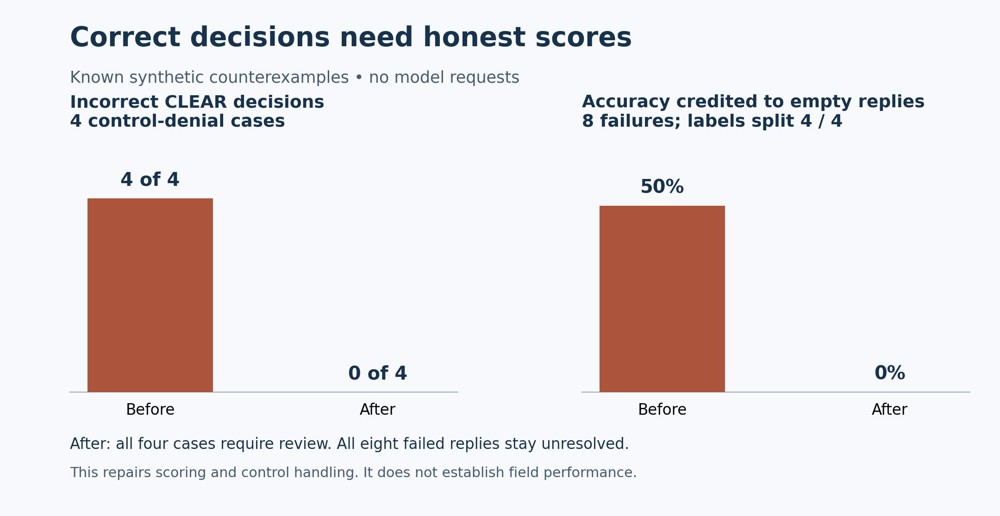

# Correct decisions need honest scores

We found two bugs that made the auditor look more reliable than it was. Some observations were cleared because they contained a control word, even when the sentence said that control was missing. Failed model replies could also become negative predictions and receive credit in the score.

Both needed to be fixed before we could trust later comparisons. This change addresses those software errors and keeps the remaining uncertainty visible.

## A control has to apply to the event

“Cleaned” and “not cleaned” cannot support the same decision. The policy now checks whether the observation actually says the control was in place for the relevant event. It also checks common language about planned or late action, continuing exposure, and controls applied to another object.

The four original counterexamples now produce the following results:

| Invented observation | Before | After |
| --- | --- | --- |
| Oil spill on the employee walkway was not cleaned. | CLEAR | REVIEW |
| Crane was not grounded and came within four feet of the energized conductor. | CLEAR | REVIEW |
| Broken sling was not removed from service and remained in the active lift. | CLEAR | REVIEW |
| Work at the open edge proceeded without fall-arrest. | CLEAR | REVIEW |

REVIEW means the system has not established a supported final decision. The repair does not turn these observations into automatic legal conclusions. Paired affirmative-control tests also check that supported clearances still work. The 126 existing public synthetic policy cases kept their previous results.

The PR review also added regression cases for removed or dismantled controls, partial cleanup, renewed spills, and remaining gaps in protection. These extend the examples the policy checks. They do not provide general language understanding, and other wording or missing facts can still need review.

## An empty reply earns no correct decision

The outage check supplies eight empty replies: four cases have positive labels and four have negative labels. No model is called.

| Measure on the same eight cases | Before | After |
| --- | ---: | ---: |
| Reported accuracy | 50% | 0% strict accuracy |
| True negatives | 4 | 0 |
| Binary decisions produced | 8 inferred negative predictions | 0 |
| Failures kept unresolved | 0 | 8 |

The lower score is the correct result. The auditor made no decisions, so it should receive no credit for getting the four negative cases right. The repaired report records four unresolved positive cases and four unresolved negative cases. Its decision coverage is 0%.

New reports use `selective_binary_v2`. Strict accuracy is correct explicit decisions divided by all labeled cases, including cases left unresolved. Confusion counts contain only explicit decisions. Recall includes unresolved positives in its denominator, and `missed_positive_cases` reports unresolved positives together with explicit false negatives. Reports also show review volume, inference failures and decision coverage. Missing labels remain missing.



The [saved regression summary](results/decision_scoring_regressions.json) records these cases and source hashes. These are known software counterexamples, not an estimate of performance on unseen incidents.

## Keep evidence attached to the decision

The parser requires one complete STATUS, CITATION and REASON response. A valid-looking example buried in a larger reply is insufficient. The evidence guard checks that governing excerpts are available and that a proposed violation cites a supplied, recognized section. Those checks establish citation membership; they do not prove that a rule supports the conclusion.

When a guard rejects a proposed decision, the effective verdict becomes REVIEW. The raw reply and rejected citation remain available for diagnosis. Blocking an unsupported citation does not mean the model stopped proposing it; reports need to keep that distinction visible.

A failed critique remains unresolved. A policy decision sent to review stays in review through saved-output processing. Unresolved outputs cannot enter trusted learning memory as approved precedents.

Saved evaluations must match the supplied dataset's case IDs, labels and expected citations. Two missing citation values cannot earn citation credit. Paired comparisons match cases by ID, so changing the row order cannot silently compare different cases.

## Preserve the earlier results

The published historical reports keep their original evidence and scoring definitions. Historical scoring compatibility is limited to the exact frozen fine-tuning report. New reports must identify the current scoring schema.

The retrieval repair adds a separately named compatibility reproduction. The original retrieval comparison, protocol, freeze and result figures stay unchanged. The reproduction returns the same 140/144 expected authorities within the top 16 on the known public synthetic fixture. It establishes compatibility after the policy change, not a new retrieval gain.

## Run the checks

From a checkout of this PR with its dependencies installed:

```powershell
python -B -m unittest discover -s tests -v
python -B code/validate_saved_evaluation.py
python -B code/public_results.py --check
python -B code/report_retrieval_comparison.py --check
python -B code/validate_notebook.py
```

The regression tests use invented observations and mocked failures. The saved-result checks do not train a model or download weights. Independent evaluation and the calibration reserve remain separate. This repair does not train or promote a real model, establish field performance, or close every finding from the broader audit.
