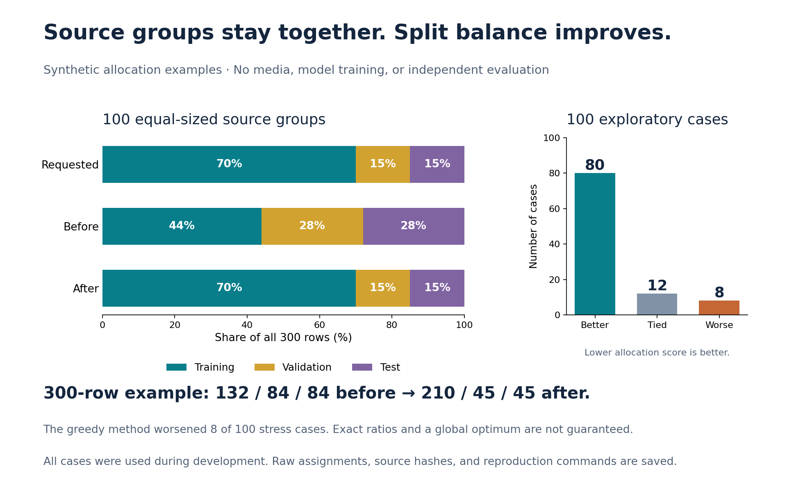

# Keep source groups together and improve split balance

The split helper could send too many rows to validation and test, even when training had the largest requested share. In the 300-row synthetic example below, a 70/15/15 request produced **132/84/84** rows. The corrected allocation produces **210/45/45**, while every source group stays together.



These are tests of data allocation. They do not measure Person detection, model accuracy, calibration, or field safety. The examples were used during development; none is an independent evaluation set. No media, learned weights, or private review records are needed.

## Matched examples

Every comparison uses the same rows, group identities, labels, seed, and requested ratios. The baseline is the splitter at commit [`2beeb66`](https://github.com/SamsonMortensen/Industrial_Safety_Agent/blob/2beeb66d422b0270b05967c9b91d23555d060261/code/vision_manifest.py). Counts are shown as **training / validation / test**.

| Synthetic example | Requested shares | Before | After |
| --- | --- | --- | --- |
| 18 rows, 6 equal groups, 2 labels | 70 / 15 / 15% | 12 / 3 / 3 | 12 / 3 / 3 |
| 36 rows, 12 equal groups, 2 labels | 50 / 25 / 25% | 12 / 12 / 12 | 18 / 9 / 9 |
| 120 rows, 40 equal groups, 2 labels | 70 / 15 / 15% | 60 / 30 / 30 | 84 / 18 / 18 |
| 300 rows, 100 equal groups, 2 labels | 70 / 15 / 15% | 132 / 84 / 84 | 210 / 45 / 45 |
| 47 rows, 7 unequal groups, mixed labels | 70 / 15 / 15% | 44 / 1 / 2 | 32 / 8 / 7 |

All five examples keep whole groups and leave all three partitions nonempty. Their exact assignments, counts, label distributions, source hashes, and allocation scores are saved in [the comparison data](results/group_split_before_after.json).

## What changed

The old rule compared each proposed partition's relative label-count error in isolation. That did not measure the change in balance across the complete allocation. The correction compares the **increase in a combined row-count and label-count error** when assigning one whole group.

For each partition and each label, the target is the total available count multiplied by the requested share. The score adds `(actual - target)^2 / target` for overall rows and for every label. A lower score means a closer match to those count targets. It is an engineering allocation objective, not a statistical hypothesis test or a confidence bound.

For a group adding `g` rows to a count `x` with target `t`, the change in that term is `(2*x*g + g*g) / t - 2*g`. The last term is the same whichever partition receives the group, so it can be omitted when comparing choices. The implementation applies this to both overall rows and per-label counts, using the actual positive targets.

Groups are still processed largest first. Group IDs and the seed determine ties, label iteration is sorted, and output rows retain their input order. Nonfinite ratios and ratios that leave no positive share for a partition are rejected. The existing final repair moves a whole group if a small manifest leaves a partition empty.

## Tradeoffs are part of the result

The fixed exploratory generator creates 100 manifests with unequal group sizes and mixed labels. On the combined allocation score, the candidate was **better in 80, tied in 12, and worse in 8** than the baseline. All 100 cases are retained, including the regressions. A tie uses relative tolerance `1e-12` and absolute tolerance `1e-10` when comparing scores.

This is a greedy method, not a global optimizer. Large indivisible groups, rare labels, and the nonempty-partition repair can prevent exact ratios. Overall row proportions and label balance can also conflict. The eight worse cases are a reason to inspect a proposed split before using it, not to claim universal improvement.

Keeping a supplied `group_id` in one partition prevents that ID from crossing splits. It does not discover duplicate footage, related scenes under different IDs, or prove that groups are statistically independent. Those remain data-design responsibilities.

## Reproduce the evidence

From a clone with the repository dependencies installed:

```powershell
python -B code/check_group_split_results.py --check
python -B -m unittest discover -s tests -p test_vision_group_splits.py -v
python -B -m unittest discover -s tests -p test_group_split_evidence.py -v
```

The first command regenerates the synthetic cases, recomputes candidate allocations, checks fixture/source identities, and recomputes both stages' metrics from their recorded group assignments. It needs no model service, camera, GPU, or internet connection. It does not rerun the historical baseline unless its exact source is supplied.

To rerun both algorithms, use a full Git clone that contains the baseline commit and a new worktree/output path:

```powershell
git worktree add --detach ../safety-split-baseline 2beeb66d422b0270b05967c9b91d23555d060261
python -B code/check_group_split_results.py --baseline-source ../safety-split-baseline/code/vision_manifest.py --out benchmark_runs/group_split_reproduced.json
```

The baseline file must match the recorded source hash before it is loaded. Existing output files are never overwritten. The saved JSON binds the candidate, fixture generator, and reproducer source hashes; integer counts and assignments are exact, while recomputed finite floating scores use the repository's narrow cross-version tolerance.

## Keep existing approvals separate

This PR changes source and synthetic evidence only. It does not regenerate existing manifests, move reserved groups, admit labels, train a model, or promote a candidate. A split named `test` is not automatically an independent evaluation protocol. Existing approved manifests and frozen candidates retain their original identities; a new allocation needs its own review and approval before use.
