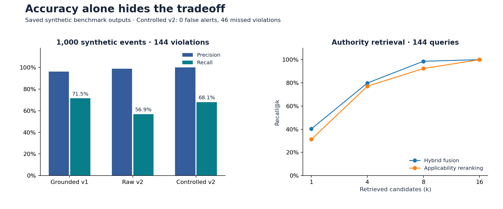
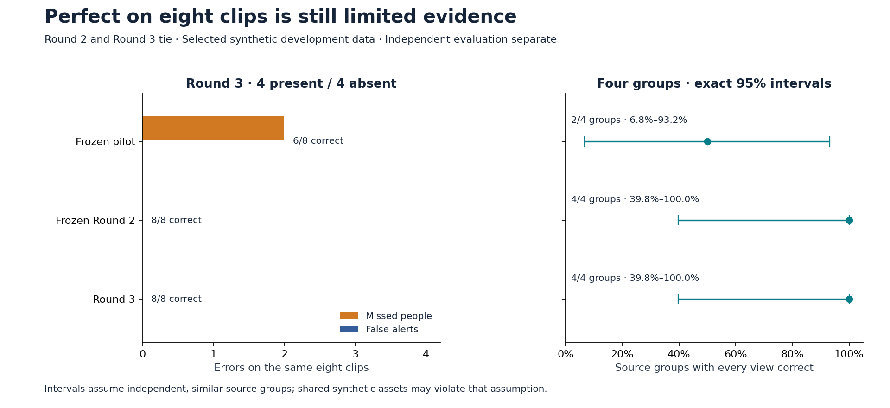
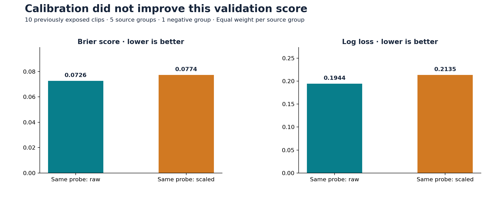

# Results and analytical decisions

Generated from saved outputs by `python code/public_results.py`. These are selected historical runs, not a complete experiment registry or a new model execution.

This project demonstrates data profiling, baseline design, matched comparisons, group-aware validation, probability diagnostics, and reproducible reporting. The results below show both gains and experiments that did not improve the chosen metric.

## Read the evidence in context

| Track | Evidence | What a public reader can reproduce |
| --- | --- | --- |
| Text audit and retrieval | Synthetic benchmark; saved predictions | Counts and retrieval curves from public per-case outputs |
| QLoRA | Synthetic, text-disjoint 56-case holdout | Format, verdict, and citation scores; no model training in this report |
| Person rounds | Selected synthetic development clips; AI-assisted human review | Metrics from anonymous validation targets and predictions |
| Calibration experiment | Previously exposed development validation | Group-weighted scores for raw and scaled predictions |
| Independent evaluation | No independent results included | Remains a separate review and evaluation process |

## 1. Audit tradeoffs and retrieval

All three audit results use 1,000 synthetic events: 144 violations and 856 nonviolations. Raw and policy-controlled v2 reuse the same saved model outputs. Grounded v1 is a separate model run. These are pipeline results, including deterministic triage, rather than isolated model-only scores.

| Pipeline | True positives | False alerts / 856 | Misses / 144 | Precision | Recall |
| --- | ---: | ---: | ---: | ---: | ---: |
| Grounded v1 | 103 | 4 | 41 | 96.3% | 71.5% |
| Raw v2 | 82 | 1 | 62 | 98.8% | 56.9% |
| Policy-controlled v2 | 98 | 0 | 46 | 100.0% | 68.1% |

**Decision:** policy controls reduced v2 errors on this fixture, but 46 violations were still missed. Grounded v1 retained higher recall. Zero observed false alerts does not establish a zero population error rate.

The separate retrieval task has 144 known-violation queries. Hybrid fusion placed the expected authority earlier more often than applicability reranking; both reached 144/144 within the top 16. Retrieval success does not establish a correct final decision.

## 2. Fine-tuning: distinguish format from domain correctness

| Saved output | Parsed / 56 | Correct verdict / 56 | Correct citation on violations / 28 | Verdict + citation / 56 |
| --- | ---: | ---: | ---: | ---: |
| Base model | 0 | 0 | 1 | 0 |
| QLoRA adapter | 56 | 50 | 16 | 41 |

**Interpretation:** all 56 base outputs failed the required parser, so its zero strict verdict score is largely a format failure. The adapter achieved 50/56 correct verdicts, but only 16/28 correct violation citations. The table does not isolate a reasoning improvement. Training used 70 synthetic cases; holdout separation was by text, not proof of domain or template independence.

## 3. Person detection: compare models on the same source groups

Camera views from the same simulation stay together. The tables compare methods within each round; different rounds have different validation sets and must not be joined into an accuracy improvement curve. Both false alerts and missed people have unit cost. Balanced accuracy is reported separately because class prevalence differs.

### First pilot

Fitting: 14 clips / 7 source groups. Validation: 4 clips / 2 source groups.

| Method | Correct | False alerts / negatives | Misses / positives | Balanced accuracy | Fully correct groups; exact 95% interval |
| --- | ---: | ---: | ---: | ---: | --- |
| Training majority | 2/4 | 2/2 | 0/2 | 50.0% | 1/2; 1.3%–98.7% |
| Fixed prompt | 2/4 | 2/2 | 0/2 | 50.0% | 1/2; 1.3%–98.7% |
| Pilot classifier | 4/4 | 0/2 | 0/2 | 100.0% | 2/2; 15.8%–100.0% |

### Round 2

Fitting: 52 clips / 26 source groups. Validation: 10 clips / 5 source groups.

| Method | Correct | False alerts / negatives | Misses / positives | Balanced accuracy | Fully correct groups; exact 95% interval |
| --- | ---: | ---: | ---: | ---: | --- |
| Training majority | 8/10 | 2/2 | 0/8 | 50.0% | 4/5; 28.4%–99.5% |
| Fixed prompt | 9/10 | 1/2 | 0/8 | 75.0% | 4/5; 28.4%–99.5% |
| Frozen pilot | 9/10 | 1/2 | 0/8 | 75.0% | 4/5; 28.4%–99.5% |
| Round 2 classifier | 9/10 | 1/2 | 0/8 | 75.0% | 4/5; 28.4%–99.5% |

### Round 3

Fitting: 80 clips / 40 source groups. Validation: 8 clips / 4 source groups.

| Method | Correct | False alerts / negatives | Misses / positives | Balanced accuracy | Fully correct groups; exact 95% interval |
| --- | ---: | ---: | ---: | ---: | --- |
| Training majority | 4/8 | 4/4 | 0/4 | 50.0% | 2/4; 6.8%–93.2% |
| Fixed prompt | 4/8 | 4/4 | 0/4 | 50.0% | 2/4; 6.8%–93.2% |
| Frozen pilot | 6/8 | 0/4 | 2/4 | 75.0% | 2/4; 6.8%–93.2% |
| Frozen Round 2 | 8/8 | 0/4 | 0/4 | 100.0% | 4/4; 39.8%–100.0% |
| Round 3 classifier | 8/8 | 0/4 | 0/4 | 100.0% | 4/4; 39.8%–100.0% |

**Decision:** Round 2 tied the frozen pilot on its ten validation clips. On Round 3's eight clips, the frozen pilot missed two people; both Round 2 and Round 3 classified every clip correctly. No classification superiority of Round 3 over Round 2 was established.

The 4/4 fully correct groups for Round 3 have a 39.8%–100% exact interval. This interval concerns the fraction of source groups with *every view correct*, not clip accuracy or a guarantee about field performance. It assumes independent, similarly distributed groups; shared simulation assets can violate that assumption. Sparse frame sampling can miss short appearances, and model-assisted review can bias labels.

Data-quality check: the first pilot's validation clips 13 and 14 have Person=Absent in the saved predictions. An equipment-collision scenario is not itself a Person label. Public exports omit clip identifiers and media paths.

## 4. Calibration: retain the negative result

This experiment fitted a new probe on 36 clips / 18 groups and a temperature on 16 clips / 8 separate groups. Its ten validation clips / five groups had already been exposed in Round 2. Only one validation group was negative. Calibration groups were excluded from this new probe but had trained earlier classifiers; the older model is contextual, not an isolated calibration control.

| Method | Group-weighted Brier ↓ | Group-weighted log loss ↓ |
| --- | ---: | ---: |
| Previous classifier | 0.0815 | 0.2363 |
| New probe, raw | 0.0726 | 0.1944 |
| New probe, scaled | 0.0774 | 0.2135 |

**Decision:** temperature scaling (T=0.8797) worsened validation Brier score for the same new probe, from 0.0726 to 0.0774. All three variants made one false alert and no misses. Positive temperature scaling leaves the 0.5 decision boundary unchanged. This candidate/calibrator was not accepted or promoted.

A later calibration-reserve fit is a different experiment and is not pooled into these results. Fit-set improvement alone cannot establish out-of-sample calibration.

## 5. Authentic incident data: measure coverage honestly

The saved OSHA incident stress test processed 500 records, triggered 500 investigations and returned nonempty candidates for 500 records. It produced 24 distinct top-ranked authorities. All sampled records were known reported incidents and human-flagged by design. This is ingestion/retrieval coverage, not detection recall or legal accuracy.

## Reproduce and extend

Run `python code/public_results.py --check` to verify the saved report against its inputs and output hashes. To regenerate the figures and tables, install `requirements-results.txt`, then run `python code/public_results.py`. No GPU, model download, service, or private campaign is needed to recompute the public metrics.

The [workflow and metric definitions](ANALYTICS_WORKFLOW.md) explain the denominators, anonymous export, and how to add future runs. [metrics.json](results/metrics.json) contains recomputed numbers; [manifest.json](results/manifest.json) records input and output hashes. The [anonymous development snapshot](../data/public_development_runs.json) reproduces historical metrics, not training or human-label verification.

Exact group intervals use the [Clopper–Pearson method](https://docs.scipy.org/doc/scipy/reference/generated/scipy.stats._result_classes.BinomTestResult.proportion_ci.html). They are descriptive under the stated group assumptions; no independent evaluation or deployment claim is made here.
