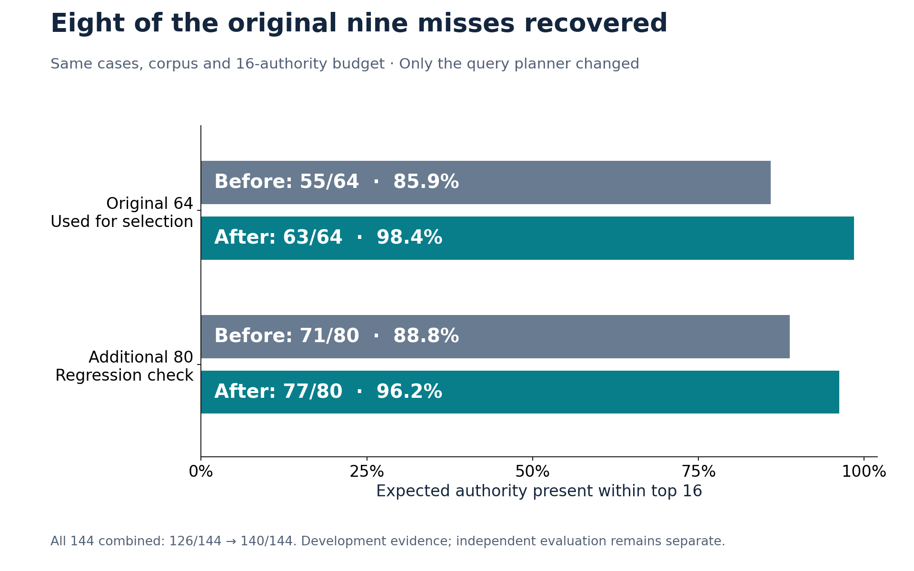
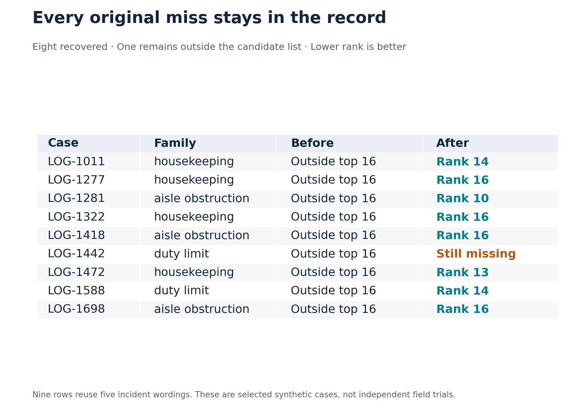
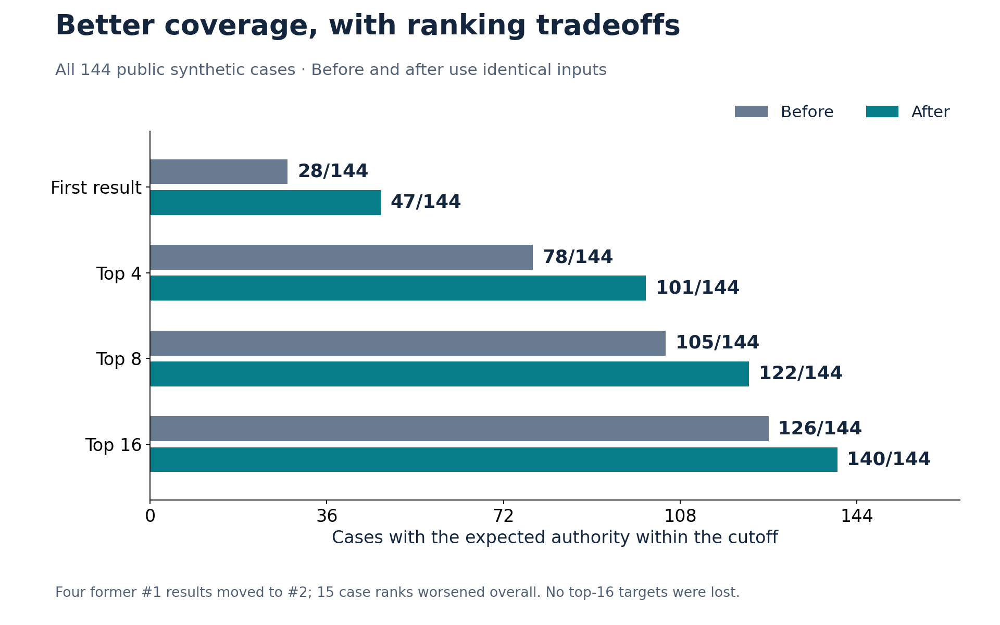

# Retrieval improvement: what changed and what it means

## Public overview

The public CPU walkthrough originally missed the expected authority in nine of 64 synthetic cases. A focused query-planning change recovered eight of those nine. It also improved the other 80 cases in the same public fixture after the candidate was frozen. All results below compare the same cases, corpus, labels, retrieval method, and 16-authority budget.



| Development cohort | Before: found / cases | After: found / cases | Change in Recall@16 | Gained / lost at top 16 |
| --- | ---: | ---: | ---: | ---: |
| Original 64 development cases | 55/64 (85.9%) | 63/64 (98.4%) | +12.5 percentage points | 8 / 0 |
| Additional 80 public cases | 71/80 (88.8%) | 77/80 (96.2%) | +7.5 percentage points | 6 / 0 |
| All 144 public cases | 126/144 (87.5%) | 140/144 (97.2%) | +9.7 percentage points | 14 / 0 |

**Reading the result:** Recall@16 asks whether the benchmark's expected authority appears anywhere in the 16 returned authorities. It does not measure whether a final decision or citation is correct. The first 64 cases were used to diagnose and select this change. The other 80 are a development regression check from the same known synthetic dataset, not independent evaluation. The all-144 row includes both subsets; do not add it as a third cohort.

**The implementation change is small:** keep the incident description in context queries and remove added generic phrases such as `federal safety requirement` and `applicable limit or minimum requirement`. Observed words are preserved, even when a user actually mentions those phrases. No citation numbers, case IDs, expected labels, or hazard-to-authority lookup rules were added to retrieval.

## The original nine misses



| Case | Hazard family | Expected authority | Before | After |
| --- | --- | --- | --- | --- |
| LOG-1011 | housekeeping | 1910.22 | Outside top 16 | Rank 14 |
| LOG-1277 | housekeeping | 1910.22 | Outside top 16 | Rank 16 |
| LOG-1281 | aisle obstruction | 1910.176 | Outside top 16 | Rank 10 |
| LOG-1322 | housekeeping | 1910.22 | Outside top 16 | Rank 16 |
| LOG-1418 | aisle obstruction | 1910.176 | Outside top 16 | Rank 16 |
| LOG-1442 | duty limit | 21103 | Outside top 16 | Still outside top 16 |
| LOG-1472 | housekeeping | 1910.22 | Outside top 16 | Rank 13 |
| LOG-1588 | duty limit | 21103 | Outside top 16 | Rank 14 |
| LOG-1698 | aisle obstruction | 1910.176 | Outside top 16 | Rank 16 |

Those nine rows contain only **5 distinct incident wordings**, repeated with different equipment, location, or measurement fields. They are not nine independent demonstrations of generalization.

## Why the queries were missing useful evidence

The query planner originally produced an incident query, relation queries, and separate equipment/location/measurement queries. When explicit action and condition fields were empty, the context queries omitted the incident. Several also appended generic regulatory wording. With multi-query rank fusion, repeated background terms could accumulate support for unrelated authorities.

For `LOG-1011`, the observation is: **Hydraulic fluid pooled across the marked walking route and left unattended.** The actual shift-measurement query changed as follows:

**Before**

```text
Terminal Tractor Main Pedestrian Crosswalk operator shift hours 9.9 applicable limit or minimum requirement
```

**After**

```text
Terminal Tractor Main Pedestrian Crosswalk Hydraulic fluid pooled across the marked walking route and left unattended operator shift hours 9.9
```

The expected housekeeping authority was outside the original top 16 and now appears at rank 14. The incident-only query was already useful; the change prevents background fields and generated legal wording from dominating the combined query set.

The diagnosis also found a chunk-pool bottleneck. Long sections can occupy many of the 50 per-query chunk slots before the retriever reduces them to distinct authorities. However, simply diversifying that pool made the 64-case result worse, so it was not included. The accepted change alters **QueryPlanner only**; BM25 scoring, fusion weights, pool size, applicability reranking, corpus text, and citation/decision gates are unchanged.

## Earlier ranks and regressions



| All 144 cases | Before | After | Cases entering cutoff | Cases leaving cutoff |
| --- | ---: | ---: | ---: | ---: |
| Recall@1 | 28/144 | 47/144 | 23 | 4 |
| Recall@4 | 78/144 | 101/144 | 23 | 0 |
| Recall@8 | 105/144 | 122/144 | 17 | 0 |
| Recall@16 | 126/144 | 140/144 | 14 | 0 |

Mean reciprocal rank, truncated at 16, rose from **0.380 to 0.507**. Higher is better: a correct authority at rank 1 contributes 1; at rank 4 it contributes 1/4; a miss contributes zero.

No previously found authority left the top 16. Nevertheless, **15 cases worsened in rank**. Four fell from rank 1 to rank 2:

| Case | Hazard family | Before → after |
| --- | --- | --- |
| LOG-1677 | sling | 1 → 2 |
| LOG-1824 | duty records | 1 → 2 |
| LOG-1918 | ladder | 1 → 2 |
| LOG-1953 | ladder | 1 → 2 |

These regressions matter if a downstream user reads only the first result. The complete per-case table includes every improvement and regression, rather than only the recovered cases.

## Four cases still need work

| Case | Cohort | Incident | Expected authority |
| --- | --- | --- | --- |
| LOG-1442 | primary64 | Covered switch employee continued yard moves past scheduled relief | 21103 |
| LOG-1485 | additional80 | Spilled coolant left across the marked pedestrian path | 1910.22 |
| LOG-1670 | additional80 | Covered switch employee continued yard moves past scheduled relief | 21103 |
| LOG-1829 | additional80 | Standing oily runoff spread over the pedestrian route with no containment | 1910.22 |

For the remaining original miss, `LOG-1442`, the best target-chunk position across its five new queries is 53, just outside the unchanged 50-chunk pool. Its short 'covered switch employee' wording has weak lexical overlap with the stored train-employee statute excerpt. This is evidence of a candidate-generation limitation, not justification to inject the expected citation. The other misses show that vocabulary differences and equipment context can still matter.

The next bounded experiments should separately test semantic retrieval, general lexical normalization, and candidate generation on development data, with the cost and rank tradeoffs recorded. Any revised corpus should retain official source provenance and be evaluated as its own change. The independent evaluation remains reserved for an approved frozen candidate.

## Technical appendix: experimental design

1. Preserved the earlier publication candidate and the 55/64 rehearsal output. Recreated the exact original case-level ranks before changing anything.
2. Used the original 64 cases for diagnosis and prototype selection. Kept unsuccessful variants in the exploration record.
3. Froze the selected query-planner source before inspecting its results on the remaining 80 public cases. No further retrieval tuning followed that inspection.
4. Compared all 144 cases with unchanged source data, labels, top-k budget, and retrieval method. Recorded paired gains/losses and all returned authority lists.
5. Ran query-boundary regressions, the public suite, saved-result checks, notebook validation, and the updated live walkthrough. Execution evidence is recorded separately from retrieval effectiveness.

### Variants examined on the original 64

| Prototype | Hits@1 | Hits@4 | Hits@8 | Hits@16 |
| --- | ---: | ---: | ---: | ---: |
| baseline | 11 | 32 | 47 | 55 |
| authority diverse pool | 10 | 19 | 38 | 46 |
| incident anchored queries | 19 | 43 | 50 | 58 |
| authority document | 10 | 23 | 37 | 49 |
| authority document anchored | 13 | 30 | 45 | 60 |
| incident anchored factual queries | 20 | 41 | 54 | 63 |

The pool-only prototype collapsed repeated authorities before the pool cutoff but retained the existing per-chunk fusion. The authority-document prototypes concatenated chunks per authority for lexical indexing. Neither index change was accepted. These are development-selection results, not six independent tests of a final model.

### How the unchanged rank fusion works

The existing retriever uses a weighted reciprocal-rank-fusion variant. Query q has weight `1 / (1 + 0.25*q)`; a chunk at rank r contributes `weight / (60 + r)`. Its fused score adds the contributions and twice its strongest contribution, then authorities are ranked by their best chunk. As a result, query content matters even when the first incident query stays unchanged. The [original reciprocal rank fusion paper](https://research.google/pubs/reciprocal-rank-fusion-outperforms-condorcet-and-individual-rank-learning-methods/) provides the background; the weighting and peak term here are this project's existing implementation.

### What these numbers do and do not establish

These percentages are exact counts on a fixed, selected synthetic fixture. Repeated templates, public exposure, and prototype selection prevent interpreting them as unbiased estimates of field performance. No new confidence interval or significance claim is made for generalization. The additional 80 cases were not used to choose this candidate during this experiment, but they belong to the same previously available benchmark. They are not an independent holdout.

The benchmark labels select the violation subset and score retrieval; they do not form queries. A retrieved authority is not a legal conclusion. The corpus is the same pinned historical corpus as before, not a verification of current law. No private calibration reserve, independent review bundle, model training, or promotion is part of this experiment.

### Reproduce the comparison

```powershell
python code/capture_retrieval_run.py --out benchmark_runs/retrieval_current.json
python code/report_retrieval_comparison.py --check --candidate-capture benchmark_runs/retrieval_current.json
```

The first command runs the current lexical pipeline with network calls forbidden. The second verifies the fresh queries/ranks against the saved after-run, then recomputes the report and checks its evidence hashes. Counts, queries, ranks and hashes must match exactly. Recomputed floating-point metrics allow only rounding differences across supported Python versions (`rel_tol=1e-12`, `abs_tol=1e-15`); saved evidence bytes and their hashes remain exact. Use a new output name on each capture; existing evidence is not overwritten.

To reproduce the before-run, run the capture script in a separate process with `--repo PATH_TO_PREVIOUS_PUBLICATION_CHECKOUT`. The retrieval code at GitHub base `026d2a645fa212537f9638059ee1fc6190edda9a` has the same retrieval behavior; the earlier reliability patch should be applied if exact recorded hashes for other modules are required. The capture rejects any dataset other than the pinned public synthetic fixture.

Install `requirements-results.txt`, then run `python code/report_retrieval_comparison.py` to regenerate this Markdown and its large, single-chart PNGs. The `--check` path uses the standard library. Charts start at zero, show exact counts and denominators, and keep the two disjoint subsets separate from their combined total.

Files: [before capture](../data/retrieval_comparison/before.json), [after capture](../data/retrieval_comparison/after.json), [matched metrics](results/retrieval_comparison.json), [every case as CSV](results/retrieval_cases.csv), [protocol](../data/retrieval_comparison/protocol.json), [candidate freeze](../data/retrieval_comparison/candidate_freeze.json), [integrity manifest](results/retrieval_manifest.json).
