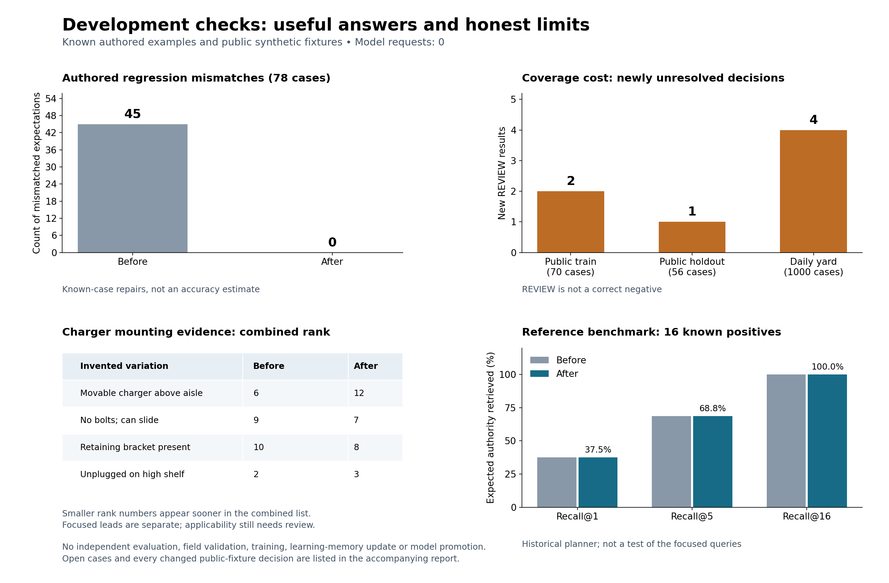

# Useful safety assessment: development results

The charger question now gets a practical first assessment and a relevant mounting passage while the final compliance decision stays at REVIEW. It explains the possible falling-equipment concern, offers conditional precautions, and asks at most two useful follow-up questions.

We also checked places where the policy was reading a hazard into a denial or assuming facts that were not there. These are known development examples. They show what changed in the software; they do not prove that it understands every situation.



## What the checks show

- Authored policy checks: **45 → 0 mismatches across 78 cases**. The expectations were written during development, not independently labeled.
- Interactive replay: **14 invented situations**, including four charger variants and the denied-hazard examples. Open expectations are listed below.
- Six notebook situations, the missing-authority check, and four simulated learning-gate examples were replayed.
- Model requests: **0**. No training, learning-memory update, independent evaluation, calibration-reserve use or model promotion occurred.

## The charger: help first, evidence next

An object that may shift or fall can deserve attention before we know its exact model. If it is unstable, keep people clear of the possible fall zone and report it for authorized inspection. The installation and the area below still need checking; missing bolts alone do not establish a violation or prescribe a specific mounting method.

The table separates the original combined candidate list from the focused evidence lead. Smaller rank numbers appear sooner. A lead is an existing candidate selected for a focused search. It is **not** a claim that the authority moved to combined rank 1.

| Invented variation | Decision before → after | Mounting rank before | Mounting rank after | First focused lead |
|---|---|---:|---:|---|
| Movable charger above aisle | REVIEW → REVIEW | 6 | 12 | 29 CFR 1910.303 |
| No bolts; can slide | VIOLATION / 1910.28 → REVIEW | 9 | 7 | 29 CFR 1910.303 |
| Retaining bracket present | REVIEW → REVIEW | 10 | 8 | 29 CFR 1910.303 |
| Unplugged on high shelf | REVIEW → REVIEW | 2 | 3 | 29 CFR 1910.303 |

Mounting moved down the combined list in 2 of the four variants: movable charger above aisle 6 → 12; unplugged on high shelf 2 → 3. The focused lead makes the relevant passage easier to find, but these mixed ranks do not establish a general retrieval improvement.

The first assessment in the saved replay:

> An elevated charger that can move deserves prompt attention: it could slide or fall from its support. The first check is stability and the area below, even while the exact compliance finding remains open.

The relevant [electrical-equipment mounting provision](https://www.osha.gov/laws-regs/regulations/standardnumber/1910/1910.303) is a research lead. Equipment height alone does not establish that a worker is exposed to falling from that height. The saved corpus is pinned to January 1, 2025; current applicability still needs review.

## Coverage cost stays visible

Removing an unsupported automatic conclusion can create more REVIEW results. That is a real coverage cost, not an extra correct negative. The public file called `holdout` is a previously used synthetic development fixture; it is separate from the reserved independent evaluation set.

| Public fixture | Cases | Changed decision/citation | Newly unresolved | Automatic-decision coverage change |
|---|---:|---:|---:|---:|
| `data/scaled_benchmark_train.csv` | 70 | 2 | 2 | -2.86 percentage points |
| `data/scaled_benchmark_holdout.csv` | 56 | 1 | 1 | -1.79 percentage points |
| `daily_yard_log.csv` | 1000 | 4 | 4 | -0.40 percentage points |

A missing rail or gate without a stated employee/activity relation to the platform, and missing ladder rungs, do not establish the automatic person-fall violation previously inferred. An open panel with exposed parts does not establish work on live parts or an actor entering an approach limit. The earlier reports are preserved; these new decisions are unresolved, not correct negative predictions.

Every changed public-fixture decision is listed here; the previous published reports are preserved.

| Fixture / case | Observation | Before | After |
|---|---|---|---|
| `scaled_benchmark_train.csv` / TR-0062 | The elevated catwalk had a missing rail and no personal fall protection | VIOLATION / 1910.28 | REVIEW |
| `scaled_benchmark_train.csv` / TR-0065 | The access platform lacked both guardrails and an approved fall-restraint connection | VIOLATION / 1910.28 | REVIEW |
| `scaled_benchmark_holdout.csv` / HO-0052 | The platform gate was absent and the employee had no restraint connection | VIOLATION / 1910.28 | REVIEW |
| `daily_yard_log.csv` / LOG-1565 | Fixed ladder to the ramp platform in use with two rungs missing | VIOLATION / 1910.28 | REVIEW |
| `daily_yard_log.csv` / LOG-1575 | Panel left open with energised parts exposed to the walkway | VIOLATION / 1910.333 | REVIEW |
| `daily_yard_log.csv` / LOG-1676 | Fixed ladder to the ramp platform in use with two rungs missing | VIOLATION / 1910.28 | REVIEW |
| `daily_yard_log.csv` / LOG-1692 | Fixed ladder to the ramp platform in use with two rungs missing | VIOLATION / 1910.28 | REVIEW |

## Interactive decision changes

Every changed status or citation in the 14-case interactive fixture is listed below. Guidance and excerpt improvements can also occur without changing REVIEW to a final decision.

| Invented observation | Before | After |
|---|---|---|
| A charger is on an elevated platform without mounting bolts. It can slide toward the aisle. | VIOLATION / 1910.28 | REVIEW |
| A pump stands on a high platform without mounting bolts. No employee is on the platform. | VIOLATION / 1910.28 | REVIEW |
| The sling has no broken wires and remains in service. | VIOLATION / 1910.184 | REVIEW |

## Open interactive expectations

These cases still do not match the desired authored outcome. REVIEW means the automated decision was withheld; it must not be counted as a correct normal case.

| Case | Desired authored outcome | Current outcome | Current reason |
|---|---|---|---|
| An oil spill remains on the employee walkway. | VIOLATION / 1910.22 | REVIEW | The deterministic policy proposed 1910.22, but that authority was not present in the retrieved candidate set. |

## All six notebook situations

| Situation | Before | After |
|---|---|---|
| Crane beside energized conductor | VIOLATION / 1910.333 | VIOLATION / 1910.333 |
| Leak contained before walkway | CLEAR | CLEAR |
| Damaged sling in active lift | VIOLATION / 1910.184 | VIOLATION / 1910.184 |
| Electrical state unknown | REVIEW | REVIEW |
| Forklift shift context; requested review | REVIEW | REVIEW |
| Unchanged scene | NO_ACTION | NO_ACTION |

CLEAR applies only to the checked condition. NO_ACTION means the trigger did not fire; it does not certify the area as safe.

## Grounding and learning gates

With the proposed authority deliberately withheld, the result was **REVIEW → REVIEW**. A proposed citation cannot become grounded merely because the policy suggested it.

| Simulated example | Before | After |
|---|---|---|
| Unreviewed prediction | Not trusted | Not trusted |
| Matching synthetic label | Eligible | Eligible |
| Simulated approved review | Eligible | Eligible |
| Citation conflicts with the label | Not trusted | Not trusted |

These are simulated eligibility checks. They are not real reviewer approvals, memory updates or training runs.

## Reference retrieval benchmark

This separate 16-case check keeps the published reference query planner. It does not measure the new interactive query expansions, false alarms on normal work, or legal correctness.

| Metric | Before | After |
|---|---:|---:|
| Recall@1 | 37.5% | 37.5% |
| Recall@5 | 68.8% | 68.8% |
| Recall@16 | 100.0% | 100.0% |

Expected labels select and score these known positive cases; they do not form the search queries.

## Rerun the public checks

From the repository root, using the project's configured Python environment:

```text
python -B -m unittest discover -s tests -p test_hazard_assertions.py -v
python -B -m unittest discover -s tests -p test_investigation_support.py -v
python -B -m unittest discover -s tests -p test_helpful_investigation.py -v
python -B code/showcase.py --benchmark-cases 16 --json
```

The tests replay the authored hazard checks and the public `data/investigation_development_cases.json` observations. The walkthrough prints the six notebook results, grounding and learning-gate examples, and the reference retrieval ranks. These commands check the current revision; they do not regenerate the historical before snapshot or train a model. The JSON below identifies the before commit, exact source hashes, every expected outcome and all changed public-fixture decisions for inspection.

## What to improve next

Review fresh positive, normal and uncertain examples from separate source groups. Measure missed hazards, false alerts, unresolved decisions, useful guidance and citation support together. Improve the weak retrieval or interpretation step before deciding that more model training is the answer. The [development-data plan](USEFUL_SAFETY_ASSESSMENT.md) proposes a bounded first batch and keeps independent evaluation separate.

The [machine-readable results](results/useful_assessment_development.json) include all case outcomes, combined ranks, exact excerpt provenance, source hashes and saved-input hashes. Nothing here replaces a safety-domain review or a field trial.
