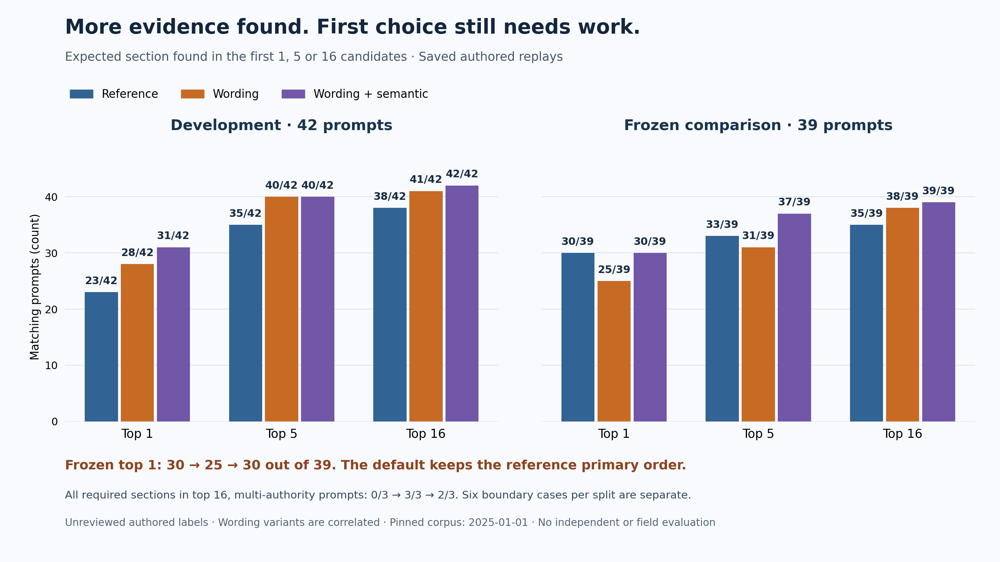

# Wording should not decide whether we find useful evidence

We found a real retrieval problem. “An oil spill remains on the employee walkway” could miss the relevant walking-surface section, even though a plural version retrieved it. We also found that a promising fix could recover more sources while making the first choice worse on other prompts. Both findings matter.

The default keeps the existing primary candidate order and adds separate wording research leads. The expanded ranker is available for explicit experiments. A retrieved passage can help investigate a condition; its rank does not prove that it is the governing citation or that a violation occurred.



## What the saved runs show

“Top 1” means the expected section was the first candidate. “Top 5” and “top 16” mean it appeared somewhere in those lists. These counts measure section retrieval, not violation accuracy, paragraph accuracy, or independently verified legal applicability.

| Split | Retrieval profile | Top 1 | Top 5 | Top 16 |
| --- | --- | ---: | ---: | ---: |
| Development | Reference | 23/42 | 35/42 | 38/42 |
| Development | Wording | 28/42 | 40/42 | 41/42 |
| Development | Wording + semantic | 31/42 | 40/42 | 42/42 |
| Frozen comparison | Reference | 30/39 | 33/39 | 35/39 |
| Frozen comparison | Wording | 25/39 | 31/39 | 38/39 |
| Frozen comparison | Wording + semantic | 30/39 | 37/39 | 39/39 |

The development results improved. The frozen comparison showed why that was not enough to replace the default. Wording retrieval lost six previously correct first choices and gained one. Adding semantics lost three and gained three, tying the reference total. Equal totals can hide changed answers.

The semantic profile found the expected section somewhere in the top 16 for all 39 single-authority comparison prompts. It still did not identify the expected first choice on nine of them. We therefore treat the result as better evidence coverage on this sample, with unfinished ranking work.

Three other comparison prompts needed multiple authorities. All required sections appeared in the top 16 for **0/3 reference, 3/3 wording and 2/3 semantic** runs. Those cases are separate from the 39-prompt table; finding only one required section does not count as complete coverage. Development had no corresponding multi-authority cases.

The [chart data](results/wording_profile_summary.json) includes the counts, denominators, source replay hashes and paired first-choice changes. Earlier result reports remain separate.

The [case-level comparison](results/wording_retrieval_comparison.json) records every prompt, target and retrieved order. After the comparison, the release wrapper restored the reference default and corrected question-routing and input-limit behavior. A [separate verification](results/wording_release_verification.json) replayed all 96 prompts through each of the three profiles and matched every saved query and candidate order. That replay checks the release wiring; it is not another unseen evaluation.

## Why the original wording failed

The reference lexical search used literal tokens. It did not connect “spill” with “spills,” and everyday “walkway” phrasing differed from the source’s “walking-working surfaces.” Common words such as “employee” could then become the main overlap.

The candidate limit also applied to chunks before duplicate sections were removed. A long section with many matching chunks could crowd out a more useful section. Increasing the pool alone did not solve the missing vocabulary match.

The experimental retriever now:

- Keeps the raw lexical channel and adds word-form normalization on both the query and source text.
- Uses a small, visible search vocabulary for related wording, such as walking surfaces and passageways. It contains no citation lookup table.
- Offers bounded spelling hypotheses only when a one-edit correction is unambiguous within the corpus. It keeps the original observation intact.
- Applies the candidate budget to distinct authorities before pooling their evidence.
- Exposes shared terms, search concepts and source ranks so a match can be inspected.
- Selects verbatim excerpts using normalized wording and concepts, retaining the original source offsets.

The vocabulary is deliberately limited. It does not establish the presence of a hazard, handle every language or understand every possible description. Negated and controlled conditions can need the same source material as an unsafe report; retrieval must not turn those shared topics into an automatic violation.

## How the profiles are used

The default `reference` profile preserves the primary ranking. Additional wording results appear as research leads for review. They do not replace the primary candidate list or establish a legal conclusion.

```bash
python code/showcase.py --text "An oil spill remains on the employee walkway." --benchmark-cases 0 --json
```

Use the explicit profile to experiment with the new ordering:

```bash
python code/showcase.py --retrieval-profile wording --text "An oil spill remains on the employee walkway." --benchmark-cases 0 --json
```

Semantic retrieval is a separate local option. It requires an existing frozen passage index and the SHA-256 digest of the installed embedding model. Both options must be supplied together with the wording profile:

```bash
python code/showcase.py --retrieval-profile wording --semantic-index path/to/frozen-index.npz --embedding-digest YOUR_INSTALLED_MODEL_SHA256 --text "Describe the condition here." --benchmark-cases 0 --json
```

The path and digest above are placeholders for local resources. The default does not load an encoder or download a model. Semantic retrieval is not training or model promotion. Its similarity scores are ranking signals, not calibrated probabilities.

## Where a useful-looking match can still be wrong

Each split has six boundary prompts, separate from the retrieval counts above. They cover a missing authority, an unrelated request or insufficient facts. The pinned corpus lacks the expected machine-guarding section **1910.212** used in development and noise section **1910.95** used in the frozen comparison. Better ranking cannot supply a source that is absent.

The new output kept `accepted_as_correct=false` on these cases, but could still show an unsuitable tentative lead:

| Split | Profile | Marked accepted | Tentative lead displayed |
| --- | --- | ---: | ---: |
| Development | Wording | 0/6 | 4/6 |
| Development | Wording + semantic | 0/6 | 4/6 |
| Frozen comparison | Wording | 0/6 | 5/6 |
| Frozen comparison | Wording + semantic | 0/6 | 5/6 |

The reference replays did not include these new alignment fields, so the corresponding reference counts are not comparable. Zero accepted matches is a reporting safeguard. It does not mean the system correctly rejected every boundary case. The overlap filter is a research display rule, not a validated confidence model or a substitute for checking source coverage.

## What the experiment does and does not establish

Each split contains 48 authored prompts with unreviewed reference labels. Development has 42 single-authority prompts and six boundary prompts. The frozen comparison has 39 single-authority prompts, three multi-authority prompts and six boundary prompts. Each underlying scenario has three wording variants. These variants are correlated, and scenario groups share hazard families; 42 or 39 prompts are not that many independent incidents.

The corpus is pinned to **2025-01-01**. The development set informed the changes. The comparison was frozen before its run and is now consumed; it cannot be reused as an unseen test of later improvements. No independent evaluation data, calibration reserve, real model training or model promotion was used.

This is evidence that the wording problem can be addressed and that the regression checks are useful. It is not proof of field reliability, unrestricted self-improvement, or a correct citation for every prompt. The next ranking change needs fresh comparison groups, reference review by a safety-domain reviewer, and checks for both first-choice quality and missing-source behavior. More data should broaden the situations and source coverage we can assess, while preserving the separation between development and independent evaluation.
